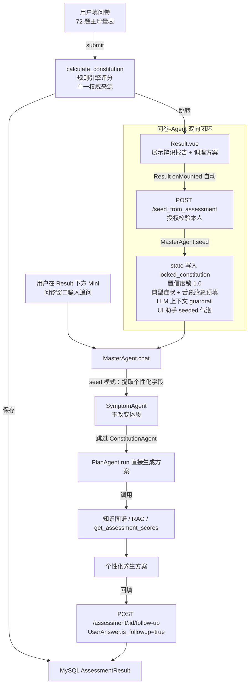

# 中医体质辨识智能诊疗系统

<p>
  
  
  
  
  
  
</p>

> 基于 **多 Agent 架构 + 知识图谱 + RAG** 的中医体质辨识与养生推荐系统。
> 系统通过「症状分析 → 体质推理 → 方案生成」三级协同 Agent 完成智能问诊，结合 Neo4j 知识图谱、向量检索（RAG）与置信度门控幻觉抑制，输出个性化养生方案，并提供五级容错降级保障。

**30 秒速览**——这不是一个"跑通 demo"的项目，每个数字都有可复现的出处：

| 维度 | 结果 | 数据来源 |
|---|---|---|
| 幻觉抑制 | 幻觉率 38.0% → **4.3%**（已回答样本口径，n=50） | `docs/evaluation/latest_report.json`（确定性解码，参数随报告落盘） |
| 门控有效性 | 阈值 0.80，拒答 8%，拦住 s022 低置信错答 | `docs/evaluation/threshold_sweep.json` + CI 门禁脚本 |
| 启动性能 | `create_app()` **256s → 0.92s**，重资源 7.7s 后台预热 | `scripts/check_startup_budget.py`（CI 门禁） |
| 并发 | 20 并发 **250 req/s**，P95 **125ms**，错误率 0% | `scripts/load_test.py` |
| 延迟归因 | 稳态 13.6s 中 **LLM 占 100%**，非 LLM 仅 0.01s | `scripts/profile_latency.py` |
| 工程化 | **61 个测试 / 13s 全离线**，Docker Compose 一键起 5 个服务 | pytest + GitHub Actions |

> 同时也写清楚边界：门控拦不住"自信地错"（2/50 高置信错答），`temperature=0` 也不是严格确定（Ollama 浮点抖动），统计口径一律双列、不挑好看的那个。

---

## ✨ 技术亮点

- **多 Agent 串行流水线**：`MasterAgent` 仲裁调度 `症状分析 / 体质推理 / 方案生成` 三个子 Agent，多轮对话状态管理。
- **问卷体质 ↔ 多 Agent 双向闭环**：问卷提交（王琦 72 题规则引擎 `calculate_constitution`）的 AssessmentResult 作为**单一权威体质来源**，通过 `POST /api/agents/seed_from_assessment` 锁死 Agent state 的 `locked_constitution`，chat() 时**跳过症状提取与 LLM 体质推理两步**、置信度固定 1.0，直接用 PlanAgent 输出个性化方案——彻底避免"问卷判一种、Agent 从自然语言又判一种"的口径漂移。
- **CoT 思维链模板**：三个 Agent 各自独立的 Few-shot Chain-of-Thought 提示词，强制"逐步推理 → 结构化 JSON 输出"。
- **LLM Function Calling**：Qwen2.5-3B（Ollama / 本地 Transformers）+ LangChain `bind_tools`，让模型自主调用 RAG、知识图谱工具与**问卷得分查询工具** **`get_assessment_scores`**、**专属调理方案工具** **`get_conditioning_plan`**；Ollama 模式下**无需本地加载权重即可调用**（通过 USE\_OLLAMA + OLLAMA\_URL 双模式，自动做结构/空值兜底）。
- **RAG 案例匹配**：`bge-small-zh-v1.5` 句向量 + FAISS 向量检索，召回相似证型案例辅助辨证；**支持本地权重（项目根目录放置即可，config 默认会自动拼接绝对路径）与 HuggingFace 在线 ID 两种模式**。
- **置信度 0.80 门控幻觉抑制**：低于阈值触发反问澄清而非直接下结论。阈值不是在配置文件里拍一个数——`scripts/threshold_sweep.py` 用 50 例标注集的 `(置信度, 预测)` 做离线回放，扫出「拒答率 × 幻觉率」曲线后选点（0.60 时门控 0 触发、等于没装；0.80 下拒答 8%，已回答幻觉率由 6.0% 降到 4.3%）。方案实体锚定知识图谱，抑制编造穴位/食材（*问卷 seed 模式下置信度锁定为 1.0，不再触发拒答澄清*）。AI 结构化输出异常时会**自动回落到知识图谱基础推荐**，不会把 `{error, raw}` 错误 dict 渲染成"暂无推荐"。
- **MCP 协议**：独立 MCP Server 暴露 **6 个工具**（新增 `get_assessment_scores` / `get_conditioning_plan`），支持 stdio / 本地双模式调用；**Windows 下 UTF-8 编码 + lazy init + 连接后 warmup 预热，保证冷启动稳定不超时**。
- **多轮对话持久化**：后端 state 三字段（LLM 上下文 `history` + UI 气泡 `chat_messages` + 问卷先验 `locked_constitution/seed_source`），前端 Pinia + localStorage 双持久化，**刷新浏览器/切页/Flask 重启均能恢复聊天记录与问卷锚定横幅**，后端会话过期时本地缓存兜底。
- **结果页内嵌迷你问诊 + 6 类『问 AI』快捷按钮**：Result.vue 下方嵌入 AgentChatPanel（mini 模式），onMounted 自动 seed；穴位/食疗/运动/疗法/健康科普/注意事项 每张卡片右下角一键发送定制追问（『为什么推荐足三里？』『痰湿质推荐的薏米红豆汤一周喝几次？』等），无需跳转独立页面。
- **Follow-up 双向回填**：Agent 追问到的饮食禁忌/用药/作息/慢性病史等个性化信息写回 `UserAnswer.is_followup=true`（`UserAnswer.answer_value` 为 Integer 列时自动拼接 `问题 ||FOLLOWUP_ANSWER|| 回答` 到 `question_content` 并 answer\_value=0 做伪 upsert），下次 seed 时可一并读入。
- **可观测与评测**：运行时观测 + 50 例临床样本自动化评测（**确定性解码**，`temperature=0`，运行参数随报告落盘）。幻觉率 38.0% → 4.3%（已回答样本口径，相对下降 88.6%），拒答率 8.0%；报告原始输出见 `docs/evaluation/latest_report.json`（已纳入版本控制，clone 即可核对），阈值扫描结果见 `docs/evaluation/threshold_sweep.json`。另含检索层离线评测（Recall@K / MRR，`python evaluate_rag.py`）。
- **启动与性能工程**：应用工厂重资源惰性化 + 后台预热，`create_app()` 从 256s 降到 **0.9s**；访问日志改 `QueueHandler` 异步落盘，20 并发下 `/health` P95 从 616ms 降到 **88ms**；20 并发混合读接口 **250 req/s / P95 125ms / 错误率 0%**（数据与复现命令见下文「启动性能与并发压测」）。启动预算有 CI 门禁，测试 61 个、本机全量 13s 左右跑完（CI 双版本矩阵约 20s）。

---

## 🏗️ 系统架构

```
[前端 Vue3 + Vite + ECharts]
        │ HTTP (Axios)
        ▼
[后端 Flask REST API]
        │
        ├─ 问卷路径（72 题量表 + 规则引擎单一来源）
        │   ├─ POST /api/assessment/submit ──▶ calculate_constitution ──▶ AssessmentResult（MySQL）
        │   └─ Result.vue ──▶ POST /api/agents/seed_from_assessment ──▶ MasterAgent.seed()
        │                                                        │
        │                                                        └─▶ state.locked_constitution（置信度=1.0，跳过两步）
        │
        ├─ 问诊路径（Agent 三级协同 / 问卷 seed 短路）
        │   └── /api/agents/chat ──▶ MasterAgent（主控仲裁）
        │                          ├── SymptomAgent（症状/个性化信息提取 · seed 模式仅保留后者）
        │                          ├── ConstitutionAgent（体质推理 · seed 模式短路绕过）──▶ RAG 召回
        │                          └── PlanAgent（方案生成，两种模式共享）──────▶ 知识图谱
        │
        ├── MySQL（用户/题目/测评结果/UserAnswer.follow-up 双向回填）
        ├── Neo4j（知识图谱：1500+ 节点）
        └── MCP Server（6 工具 · 新增 get_assessment_scores / get_conditioning_plan） / 本地工具注册表
```

**两种入口的一致性保障**：无论从 Result.vue 内嵌 mini 窗口、顶部「去多 Agent 页面深入问诊（带 `?from_assessment=X` query）」、还是独立 Agent 页面手动从历史问卷导入——都走同一个 `POST /api/agents/seed_from_assessment` 接口，**绝不允许 LLM 单独推导体质**（`history[0]` 的系统 guardrail + `locked_constitution` 结构化双重锁定），彻底避免口径漂移。

---

## 🧩 多 Agent 协同流程

系统提供 **两条并行协同路径**，PlanAgent 下游与幻觉抑制/实体锚定/五级容错完全共享：

### 路径 A：纯自然语言问诊（首次使用、无问卷结果用户）

| 阶段 | Agent                 | 职责                                      | 输出                                                |
| ---- | --------------------- | ----------------------------------------- | --------------------------------------------------- |
| 一级 | `SymptomAgent`      | 从主诉提取结构化症状、归一化舌象/脉象     | `{symptoms, tongue, pulse, completeness}`         |
| 二级 | `ConstitutionAgent` | RAG 召回 + CoT 推理体质/证型 + 置信度校准 | `{constitution, syndrome, confidence, reasoning}` |
| 仲裁 | `MasterAgent`       | 置信度`< 0.80` 拒答并反问澄清；否则放行 | 澄清问题 / 放行                                     |
| 三级 | `PlanAgent`         | 调用图谱工具生成穴位/食材/运动方案        | `{acupoints, foods, exercises, precautions}`      |



**置信度门控**：`calibrate_confidence(llm_conf, rag_score, completeness) = 0.45·llm + 0.40·rag + 0.15·完整性`；RAG 证据弱时上限压低至 0.55，从源头抑制"高自信胡说"。

### 路径 B：问卷体质先验（已完成问卷测评用户 · **seed 模式**）

| 阶段        | 动作                                                   | 说明                                                                                                                                                                                               |
| ----------- | ------------------------------------------------------ | -------------------------------------------------------------------------------------------------------------------------------------------------------------------------------------------------- |
| 先验        | `POST /api/agents/seed_from_assessment`              | 从`AssessmentResult` 加载主/兼夹体质与分数；授权校验必须是当前用户本人的测评（否则 403）                                                                                                         |
| 0a          | state 初始化                                           | `locked_constitution`（主/兼夹/分数/判定依据）；典型症状去重前 8 条；舌象脉象推断；`turn=0`（不计入对话轮次）                                                                                  |
| 0b          | LLM 上下文 guardrail                                   | `history.insert(0, 系统消息)` 明确告知 LLM"已按王琦量表锁定体质 X，禁止重新推导体质，若用户质疑先解释判定依据，再建议重新测评"——只写入 history，**不写入 chat\_messages 避免污染 UI**    |
| 0c          | UI 锚定横幅                                            | `chat_messages` 追加一条 stage='seeded' 助手绿色气泡；前端显示「✅ #N 问卷测评锚定 · 主 XX · 兼夹 XX · 判定依据」横幅                                                                         |
| 用户输入    | `SymptomAgent` 精简职责                              | 仅从 free text 中提取**非体质类个性化字段**（饮食禁忌/用药史/睡眠/慢性病/女性经期等），合并成 `merged_symptom["个性化信息"]` 供 PlanAgent 使用；**不改变 accumulated\_tongue/pulse** |
| 体质推理    | **完全跳过** **`ConstitutionAgent.run`** | 直接构造`constitution_result`：`confidence=1.0`、`seed_from_assessment_id=<id>`、reasoning=`本结果基于 #X 号王琦量表问卷测评：判定依据...`                                                 |
| 仲裁 & 拒答 | 跳过置信度门控澄清                                     | 因为问卷已完成、体质先验已锁定（即使 completeness=部分），缺的只是用户偏好，不会再反问"你平时怕冷吗？"                                                                                             |
| 方案生成    | PlanAgent 共享原有链路                                 | 调用 Neo4j / MCP / get\_assessment\_scores 工具，结构与路径 A 100% 一致（可在同一 store/组件里渲染相同气泡）                                                                                       |

> **判定说明的单一来源**：路径 A 的 CoT 推理 reasoning（由 LLM 自然语言）、路径 B 的问卷判定依据 reason 字符串，以及工具 `get_assessment_scores` 返回给用户解释的 reason — 全部调用同一个函数 `backend/app/services/constitution.py::build_assessment_reason(primary, secondary, scores)`，**保证三种展示场景下的判定口径绝对一致**（对应 Experience 100037039 的单一来源原则）。

---

## 🔍 RAG 检索链路

```
症状 + 舌象 + 脉象
  → 多模态特征拼接（文本模拟）
  → bge-small-zh-v1.5 句向量
  → FAISS 内积检索 top-k
  → 返回相似证型案例 → 注入 CoT 提示词
```

- 案例库：`data/rag/syndrome_cases.json`（30 例证型案例）
- 向量索引：`data/rag/faiss_index.npy` + `faiss_meta.json`
- 降级：`sentence-transformers` → `TF-IDF`；`FAISS` → `NumPy` 暴力检索
- **句向量模型两种模式**：

  - **本地权重（推荐，离线）**：把 HuggingFace 导出的 `bge-small-zh-v1.5/` 整个目录放在**项目根目录**（与 `backend/`、`frontend/` 同级），系统会自动识别；`backend/.env` 里：

    ```dotenv
    EMBEDDING_MODEL=f:/path/to/tcm-knowledge-graph-main/bge-small-zh-v1.5
    ```

    （`backend/app/config.py` 默认值也会自动指向项目根下的 `bge-small-zh-v1.5/`，即使 `.env` 未配置也能工作）
  - **HuggingFace 在线（默认，需联网）**：

    ```dotenv
    EMBEDDING_MODEL=BAAI/bge-small-zh-v1.5
    ```

---

## 🛡️ 幻觉抑制机制

1. **置信度门控拒答**：体质置信度 `< 0.80` 时拒绝下结论，返回 1\~2 个澄清问题（阈值取值依据见「评测结果 → 50 例扫描」，`.env` 与代码默认值已对齐，CI 有门禁防止被调回失效区间）。
2. **方案实体锚定（Grounding）**：`PlanAgent` 生成的穴位/食材/运动必须来自知识图谱返回集合，图谱不存在的实体一律剔除并记入观测。

---

## 🔁 五级容错降级

| 级别 | 能力       | 主路径                    | 降级路径         |
| ---- | ---------- | ------------------------- | ---------------- |
| 1    | 大模型推理 | Qwen2.5-3B（Ollama/本地） | 规则引擎         |
| 2    | 句向量编码 | bge-small-zh              | TF-IDF           |
| 3    | 向量检索   | FAISS                     | NumPy 暴力检索   |
| 4    | 工具通道   | MCP Server                | 本地 Python 调用 |
| 5    | 知识图谱   | Neo4j 在线查询            | 静态知识底库     |

---

## 🔌 MCP 协议

`backend/mcp_server/server.py` 通过 stdio 暴露 6 个工具，Flask 后端用 `MCPClient` 以子进程拉起并调用；连接失败或首次调用超时（TOOL\_TIMEOUT）后自动回退本地调用。

| 工具                                 | 说明                                                                                                               |
| ------------------------------------ | ------------------------------------------------------------------------------------------------------------------ |
| `get_constitution_recommendations` | 体质 → 穴位/食材/运动/疗法/注意事项                                                                               |
| `search_symptoms`                  | 症状全文检索                                                                                                       |
| `get_acupoint_prescription`        | 体质 → 穴位处方                                                                                                   |
| `retrieve_similar_cases`           | 症状/舌象/脉象 → 相似证型案例（RAG，首工具调用会触发 torch/sentence-transformers/FAISS lazy init）                |
| `get_assessment_scores`            | 问卷测评 ID → 体质分数、类型、判定说明（单一口径：constitution.build\_assessment\_reason）                        |
| `get_conditioning_plan`            | 获取与 Result.vue 页面**口径一致**的专属调理方案（优先读 `enhanced_recommendations`，否则 Neo4j 基础推荐） |

### Windows 下的稳定性说明

MCP 协议在 stdio 上传输 JSON-RPC，对编码、启动耗时、进程环境一致性有严格要求。本项目已默认处理以下 Windows 特有的坑：

1. **解释器环境一致**：`MCP_SERVER_CMD` 默认使用 `sys.executable`（**当前运行 Flask 的 Python 解释器绝对路径**），避免 `pip install mcp` 装在 venv 里但 `python` 命令指向系统 Python，导致 `ModuleNotFoundError: No module named 'mcp'`。
2. **UTF-8 编码**：MCPClient 拉起子进程时注入 `PYTHONIOENCODING=utf-8` 和 `PYTHONUNBUFFERED=1`；`server.py` 启动第一时间 `sys.stdout.reconfigure(encoding='utf-8')`，双重保证中文日志不输出 GBK 字节污染 JSON-RPC 帧（否则会触发 `CancelledError via cancel scope`）。
3. **Lazy init + 后台 warmup**：`server.py` 仅在**首次工具调用**时才 import `KGRetriever` / `CaseRetriever` / `py2neo.Graph` 等重型模块，保证 `initialize + list_tools` 握手 ≤ 1.5s 不超时；**握手成功后 MCPClient 立刻在后台异步提交 warmup**（顺序调用 `retrieve_similar_cases` 与 `get_constitution_recommendations`），提前把 py2neo/torch/sentence-transformers/FAISS/bge-small-zh 全部预热好，用户第一条真实消息到达时就已是稳态 1–3s。
4. **工具级超时**：默认 `TOOL_TIMEOUT=60.0`（.env 可覆盖）。冷启动首次工具调用若仍触发超时，工具注册表会**自动回退本地 Python 调用**，并在下一次调用时重新尝试 MCP 模式；warmup 完成后后续请求全部第 1 次命中 MCP。
5. **Debug reloader 双进程规避 + 优雅关闭**：Flask `debug=True` 时通过 `WERKZEUG_RUN_MAIN` 环境变量识别 werkzeug 监控父进程，父进程不连 MCP，只让真正 worker 建立 stdio 通道。worker 退出时（Ctrl+C / reloader 重启 / 正常退出）MCPClient 会**先关 session 与 stdio 管道 → 再停事件循环 → join 后台线程**（atexit 自动注册），warmup 协程被取消时内部静默吞掉 `CancelledError/KeyboardInterrupt/SystemExit`，`server.py` 顶层也对这些"正常生命周期末尾取消"只打一行 INFO，不会向 stderr 喷 40 行红 traceback。
6. **连接超时放宽**：默认 `MCP_CONNECT_TIMEOUT=60`，可在 `.env` 中覆盖（慢机器首次握手若仍超时可调到 `120`）。

> 生产部署（`gunicorn` / `docker compose up -d`）不受 1/5 影响；但 2/3/4/6 对所有环境均有益。

---

## 📊 评测结果

`backend/evaluation.py` 基于 **50 例已标注临床样本**（含 9 种体质、约 25% 为症状模糊的不典型样本）自动运行 `SymptomAgent → ConstitutionAgent(RAG) → 置信度门控 → 体质类型预测` 流水线，与 ground-truth（`gt=`）对比；同时保留"基线（无 RAG / 无拒答）"做对照。

### 评测数据汇总（2026-11-04 · 确定性解码 · Ollama qwen2.5:3b + bge-small-zh-v1.5 + FAISS）

> 运行参数随报告落盘（`run_config`）：`temperature=0.0`、`confidence_threshold=0.8`、`deterministic=True`。

| 指标                         | 基线（无 RAG / 无拒答） | 新机制（多 Agent + RAG + 门控） |
| ---------------------------- | ----------------------- | ------------------------------- |
| 样本总数                     | 50                      | 50                              |
| 拒答率（阈值 0.80）        | — （无此机制）          | **8.0%**（4/50）                     |
| 医学幻觉率（已回答样本口径） | **38.0%**（19/50）      | **4.3%**（2/46）                   |
| 幻觉率相对下降               | —                       | **88.6%**（已回答口径）/ 89.5%（全样本口径，报告 `metrics` 主指标） |
| 全样本口径幻觉率             | 38.0%                   | 4.0%（2/50）                   |
| 基线准确率                   | **62.0%**（31/50）      | —                               |
| 新机制准确率（已回答样本）   | —                       | **95.7%**（44/46）                   |
| 平均单轮延迟                 | —                       | **16.65s**                      |
| 延迟达标率（< 3s）           | —                       | 0.0%                       |

**为什么用「已回答样本」口径**：拒答是"不给结论"，不是"给了错结论"，把它算进幻觉率分母会同时低估幻觉率、美化准确率。两个口径都列出来，避免只挑好看的那个。

**两个基线不要混淆**：上表 38.0% 是「初版流水线（无 RAG、无 CoT、无门控）」的历史基线，衡量的是整套架构的价值；而下方阈值扫描表里 0.600 行的 6.0%（3/50）是「当前架构、只把门控关掉」，衡量的是门控本身的边际贡献。两者对照对象不同，不能互相替代——混着写就会得出"改了阈值幻觉率从 38% 降到 6%"这种错误结论。

### 置信度阈值不是拍脑袋定的：50 例扫描

`python scripts/threshold_sweep.py` 用同一份报告里的 `(confidence, new_pred)` 做离线回放——门控是逐样本独立判定，所以不必重跑 LLM 就能重算任意阈值的组合：

| 阈值 | 拒答数（率） | 已回答幻觉率 | 拒答精准率 | 判断 |
|---|---|---|---|---|
| 0.600 | 0（0%） | 6.0% | — | 无门控（等价不启用） |
| 0.775 | 2（4%） | 4.2% | 50% | **效率拐点**：拦住 s022 这一例低置信错答 |
| 0.800 | 4（8%） | 4.3% | 25% | **当前采用**：比拐点留一点余量，代价是多拒 2 例 |
| 0.850 | 7（14%） | 2.3% | 29% | 保守档：拦住 s006 的"自信错答"，但拒答率翻倍 |
| 0.890 | 22（44%） | 0.0% | 14% | 过度拒答：近乎半数样本都不给结论 |

读这张表能得出三个结论：

1. **0.60 的门控等于没有门控**。50 例最低置信度是 0.664，阈值低于它时触发 0 次——这正是最初的问题：机制写了，但从没通电。
2. **0.775 是效率拐点**：拒答 4% 拦住 s022 这一例低置信错答，幻觉率 6.0% → 4.2%。再往上加，每多拒一例的边际收益迅速衰减。
3. **0.775 到 0.80 之间的差异是噪声**。n=50 时单例就是 2 个百分点，s038 的置信度（0.777）与阈值差不到 0.003，换个进程重跑就可能翻转。所以**没有把阈值拟合到 0.775**，而是取 0.80 留一点余量；这个选择在统计上无法证明更优，只是风险偏好更保守，如实标注。

> 若业务更看重"零错答"，0.85 能把幻觉率压到 2.3%，代价是拒答率 14%（约每 7 人里 1 人需要补充信息）。医疗场景下这个代价通常可接受，但它会让"每次都能给出结论"的体验变差，属于产品取舍而非技术优劣。

### 门控挡不住的东西：高置信错答

门控生效后仍有 2 例错答，且**都发生在高置信区间**：

- `s006`：conf **0.846**，gt=pinghe 判成 qixu（历史回归 case，本轮仍未通过）
- `s028`：conf **0.887**，gt=tanshi 判成 pinghe

这说明置信度门控的能力边界：**它拦得住"不确定地错"，拦不住"自信地错"**。后者要靠另一层防线——方案生成阶段的实体锚定与 RAG 证据仲裁。把这两层混为一谈、宣称"门控消灭了幻觉"，是不准确的。

### 一个必须说明的局限：temperature=0 不等于完全确定

同一份代码、两次 `temperature=0` 运行，s028 一次判对一次判错，s001 的置信度出现过 0.904 / 0.936 两个值。Ollama 的贪心解码在浮点累加顺序、批调度上仍有抖动，因此：

- **分布级结论可复现**（幻觉率 ±2 个百分点、置信度分布形态稳定）；
- **样本级结论不可复现**（某一例的对错会在边界抖动）。

这也是本评测没有把单例结果当作"回归必须通过"硬门禁的原因——回归集改成区分「错答」与「拒答」两类，只有错答才让 CI 失败。

### 50 例逐条运行日志

```
======================================================================
中医多 Agent 体质辨识 · 50 例临床样本评测
======================================================================
[init] 确定性评测模式: temperature=0.0
[init] RAG 检索器就绪, backend=sentence-transformer
[init] 工具注册表就绪(本地模式)

加载临床样本: 50 例

  s001 gt=pinghe  base=✓ new=pinghe   conf=0.904 lat=31.35s  -> ✓对
  s002 gt=pinghe  base=✓ new=pinghe   conf=0.903 lat=17.37s  -> ✓对
  s003 gt=pinghe  base=✓ new=pinghe   conf=0.907 lat=12.67s  -> ✓对
  s004 gt=pinghe  base=✓ new=pinghe   conf=0.906 lat=11.46s  -> ✓对
  s005 gt=pinghe  base=✓ new=pinghe   conf=0.889 lat=26.94s  -> ✓对
  s006 gt=pinghe  base=✗ new=qixu     conf=0.846 lat=27.34s  -> ✗幻觉
  s007 gt=qixu    base=✓ new=qixu     conf=0.890 lat=21.96s  -> ✓对
  s008 gt=qixu    base=✓ new=qixu     conf=0.907 lat=28.07s  -> ✓对
  s009 gt=qixu    base=✓ new=qixu     conf=0.909 lat=30.57s  -> ✓对
  s010 gt=qixu    base=✓ new=qixu     conf=0.886 lat=22.50s  -> ✓对
  s011 gt=qixu    base=✓ new=qixu     conf=0.891 lat=25.49s  -> ✓对
  s012 gt=qixu    base=✓ new=qixu     conf=0.807 lat=23.09s  -> ✓对
  s013 gt=yangxu  base=✓ new=yangxu   conf=0.904 lat=12.98s  -> ✓对
  s014 gt=yangxu  base=✓ new=yangxu   conf=0.900 lat=13.84s  -> ✓对
  s015 gt=yangxu  base=✗ new=yangxu   conf=0.904 lat=27.77s  -> ✓对
  s016 gt=yangxu  base=✓ new=yangxu   conf=0.888 lat=18.26s  -> ✓对
  s017 gt=yangxu  base=✗ new=yangxu   conf=0.847 lat=14.81s  -> ✓对
  s018 gt=yinxu   base=✓ new=yinxu    conf=0.905 lat=16.43s  -> ✓对
  s019 gt=yinxu   base=✓ new=yinxu    conf=0.905 lat=11.57s  -> ✓对
  s020 gt=yinxu   base=✗ new=yinxu    conf=0.907 lat=13.23s  -> ✓对
  s021 gt=yinxu   base=✓ new=yinxu    conf=0.875 lat=13.99s  -> ✓对
  s022 gt=yinxu   base=✗ new=shire    conf=0.774 lat=16.81s  -> 拒答
  s023 gt=tanshi  base=✓ new=tanshi   conf=0.906 lat=12.41s  -> ✓对
  s024 gt=tanshi  base=✓ new=tanshi   conf=0.906 lat=14.00s  -> ✓对
  s025 gt=tanshi  base=✓ new=tanshi   conf=0.896 lat=15.71s  -> ✓对
  s026 gt=tanshi  base=✗ new=tanshi   conf=0.890 lat=12.71s  -> ✓对
  s027 gt=tanshi  base=✓ new=tanshi   conf=0.894 lat=13.74s  -> ✓对
  s028 gt=tanshi  base=✓ new=pinghe   conf=0.887 lat=19.64s  -> ✗幻觉
  s029 gt=shire   base=✓ new=shire    conf=0.889 lat=18.14s  -> ✓对
  s030 gt=shire   base=✓ new=shire    conf=0.906 lat=22.01s  -> ✓对
  s031 gt=shire   base=✓ new=shire    conf=0.909 lat=15.32s  -> ✓对
  s032 gt=shire   base=✓ new=shire    conf=0.877 lat=12.57s  -> ✓对
  s033 gt=shire   base=✗ new=shire    conf=0.664 lat=6.03s  -> 拒答
  s034 gt=xueyu   base=✓ new=xueyu    conf=0.887 lat=7.45s  -> ✓对
  s035 gt=xueyu   base=✓ new=xueyu    conf=0.900 lat=13.69s  -> ✓对
  s036 gt=xueyu   base=✗ new=xueyu    conf=0.905 lat=12.79s  -> ✓对
  s037 gt=xueyu   base=✗ new=xueyu    conf=0.911 lat=16.06s  -> ✓对
  s038 gt=xueyu   base=✗ new=xueyu    conf=0.777 lat=17.21s  -> 拒答
  s039 gt=qiyu    base=✗ new=qiyu     conf=0.889 lat=14.19s  -> ✓对
  s040 gt=qiyu    base=✗ new=qiyu     conf=0.863 lat=9.46s  -> ✓对
  s041 gt=qiyu    base=✗ new=qiyu     conf=0.878 lat=14.13s  -> ✓对
  s042 gt=qiyu    base=✗ new=qiyu     conf=0.905 lat=14.68s  -> ✓对
  s043 gt=qiyu    base=✗ new=qiyu     conf=0.880 lat=15.89s  -> ✓对
  s044 gt=qiyu    base=✗ new=qiyu     conf=0.863 lat=21.22s  -> ✓对
  s045 gt=tebing  base=✓ new=tebing   conf=0.895 lat=13.01s  -> ✓对
  s046 gt=tebing  base=✗ new=tebing   conf=0.881 lat=11.75s  -> ✓对
  s047 gt=tebing  base=✓ new=tebing   conf=0.892 lat=14.36s  -> ✓对
  s048 gt=tebing  base=✓ new=tebing   conf=0.938 lat=13.03s  -> ✓对
  s049 gt=tebing  base=✗ new=tebing   conf=0.869 lat=14.06s  -> ✓对
  s050 gt=tebing  base=✗ new=tebing   conf=0.783 lat=8.69s  -> 拒答

======================================================================
评测结果汇总
======================================================================
样本总数              : 50
基线幻觉率(无RAG无拒答): 38.0%  (19/50)
新机制幻觉率(多Agent) : 4.0%  (2/50)
幻觉率下降            : 89.5%
拒答率(置信度阈值)    : 8.0%  (4/50)
平均单轮延迟          : 16.65s (目标 <3.0s)
延迟达标率            : 0.0%

基线准确率            : 62.0%  (31/50)
新机制准确率          : 95.7%  (44/46)
======================================================================
```

### 3 例历史幻觉案例复盘（当前：s029 通过 / s033 拒答 / s006 仍错答）

| 样本 | ground-truth | 预测类型 | 典型症状                                                                     | 可能根因（人工复盘）                                                                                                                     | 改进方向                                                                                                                                                                                |
| ---- | ------------ | -------- | ---------------------------------------------------------------------------- | ---------------------------------------------------------------------------------------------------------------------------------------- | --------------------------------------------------------------------------------------------------------------------------------------------------------------------------------------- |
| s006 | pinghe       | qixu     | base=✗（基线就错了），典型症状里可能混入"易疲劳 / 动则汗出"等接近气虚的描述 | 平和质阈值 60 分 + 主/兼夹判定阈值边界非常接近（平和质与 8 种偏颇的边界判定是量表难题）；RAG 命中了少量 qixu 案例导致 CoT 过度自信跳类型 | 在 CoT 模板中显式加入"平和质 ≥ 60 分**且** 任何偏颇均 < 40 分，**否则只判为相应偏颇 / 兼夹**"硬规则（目前 constitution.py 是这样，要同步写入 ConstitutionAgent guardrail） |
| s029 | shire        | shire（已修复） | base=✓ （基线能判对），早期版本症状偏向"苔黄腻 + 口苦 + 大便粘"却被判为平和质 | 历史根因：RAG 中湿热 / 痰湿样本不典型或描述少（湿热与痰湿混淆）；ConstitutionAgent 的 Few-shot 里"湿热→平和"负例不够                  | **已落地**：`syndrome_cases.json` 补 5–10 条湿热 / 痰湿对比负例（舌苔黄 / 口苦 / 尿黄 vs 舌苔白腻 / 口粘 / 浮肿），CoT 里加这组对照问答；本轮 conf=0.889 判对 |
| s033 | shire        | shire（被拒答） | base=✗（基线就错了），症状同时含"情绪不畅 + 胁胀 + 舌苔腻"              | 湿热 + 情志症状叠加时，RAG 容易先命中"气郁"证型案例（情志类检索分 > 湿热）；本轮置信度 0.664，已被 0.80 门控拦下，未把错误结论抛给用户 | 门控已覆盖：低置信直接反问澄清；进一步可在"体质混淆（top2 分差 < 0.05）"时触发双判，按两种体质并集给禁忌交集 |

### 评测延迟 16.65s 说明

这个数字全部来自「体质推理 + 方案生成」两次 LLM 调用。`scripts/profile_latency.py` 从运行时 trace 聚合实测：稳态下 LLM 占 **100%**，非 LLM 部分（RAG 检索 + 规则 + 工具调用）只有 **0.01s**。50 例均值 16.65s 里含首例的向量库冷启动开销，稳态均值是 13.6s（详见下文「延迟归因」）。也就是说延迟几乎完全由本机推理速度决定，**优化 Web 层或换图数据库都不会有体感收益**——这是数据结论，不是推测。

压进 3s 的三条路径，收益可估算：

1. **问卷 seed 模式**（已实现）：锁定体质判定、跳过体质推理，2 次 LLM → 1 次，约 −50%；
2. **换更小/量化权重或 GPU 常驻**：单次推理 6.8s → 0.5–1s，量级提升；
3. **高频问答缓存**（已实现）：命中直接返回，< 50ms。

当前环境无独立 GPU，所以延迟达标率是 0%。这是硬件约束而非架构缺陷——同一套代码在 Web 层 20 并发下 P95 只有 125ms，非 LLM 部分 0.01s，瓶颈位置是明确的。

> 完整原始输出：`docs/evaluation/latest_report.json`（结构化，已纳入版本控制）。复现：
>
> ```bash
> cd backend
> python evaluation.py              # 全量 50 例
> python evaluation.py --regression # 只跑历史失败样本，错答则退出码=1
> python ../scripts/threshold_sweep.py   # 阈值扫描（离线回放，不重跑 LLM）
> ```

## 📈 可观测性

- **存活/就绪探针**：`GET /health`（liveness）、`GET /health/ready`（检查 MySQL/Neo4j/RAG + 预热状态，未就绪返回 503）。
- **运行时指标**：`GET /metrics` 返回五级容错栈 + 对话/拒答/幻觉抑制/工具调用统计。
- **结构化日志**：JSON 行日志 + 文件轮转（`backend/logs/app.log`），全链路透传 `X-Request-ID`；采用 `QueueHandler + QueueListener` **异步落盘**，访问日志不占用请求线程。
- **API 文档**：`GET /docs`（Swagger UI）、`GET /openapi.json`（OpenAPI 3.0 规范）。

---

## ⚡ 启动性能与并发压测

### 启动优化：256s → 0.9s

`create_app()` 原先在启动路径上同步做三件重活：加载句向量模型与向量库、探测 Neo4j、拉起 MCP 子进程。
结果是**启动耗时随模型体积线性增长**（实测一次 256s），且测试必须依赖外部服务。

现改为「轻量装配 + 后台预热」：

| 项目 | 优化前 | 优化后 |
|---|---|---|
| `create_app()` 装配耗时 | 256.0s | **0.92s** |
| 重资源加载 | 阻塞启动 | 后台线程 7.7s 完成（不阻塞接收流量） |
| `/health/ready` | 无预热语义 | 预热未完成时返回 503 `warmup=running` |
| 测试套件耗时 | 4m43s（且 3 个 error） | **13–25s，61 passed** |

关键改动：
- 向量库改为首个 `retrieve()` 或预热线程加载，检索器加载加双检锁；
- Neo4j 探活移出启动路径，`get_graph()` 惰性重连（30s 冷却）；
- MCP Client 移入预热线程，未就绪时工具自动走本地调用；
- 修复 `EMBEDDING_MODEL=tfidf` 被当作 HuggingFace 模型名联网解析的隐患（新增 `EMBEDDING_BACKEND` 显式选择后端）。

启动预算是**门禁**，不是口号：`python scripts/check_startup_budget.py` 超出 5s 直接退出码 1，已接入 CI。

### 并发与延迟实测

测试环境：Windows 10 / Python 3.12 / Werkzeug 多线程单进程 / SQLite / 图谱降级模式 / TF-IDF 向量。
场景为默认混合读接口（`/health` 30% + `/metrics` 20% + `/api/questions` 50%），每组 1000 请求。

| 并发 | 吞吐 | P50 | P95 | P99 | 服务端错误率 |
|---|---|---|---|---|---|
| 1 | 121.5 req/s | 4.8ms | 26.6ms | 31.3ms | 0% |
| **20** | **249.7 req/s** | **75.5ms** | **125.4ms** | **145.1ms** | **0%** |
| 50 | 250.3 req/s | 190.5ms | 273.0ms | 300.5ms | 0% |

单接口（20 并发，1000 请求）：`/health` 337 req/s（P95 88ms）、`/api/questions` 274 req/s（P95 94ms）。

**LLM 路径**（`POST /api/ai/explain-question`，Ollama qwen2.5:3b）：

| 并发 | 吞吐 | P50 | P95 | P99 |
|---|---|---|---|---|
| 1 | 1.97 req/s | 462ms | 686ms | 750ms |
| 5 | 2.31 req/s | 1837ms | 2167ms | 2211ms |

结论与取舍：
- **瓶颈在 LLM 推理而非 Web 层**：并发从 1 提到 5，吞吐几乎不变、延迟线性上升，说明单卡推理已饱和。这正是本系统做「高频问答缓存 + SSE 流式输出 + 问卷 seed 短路（跳过两次 LLM 调用）」的原因。
- **Web 层可通过多 worker 线性扩展**：会话状态已落 Redis、限流存储已接 Redis，`gunicorn -w N` 即可横向扩；当前 250 req/s 是单进程 + GIL 的上限。
- **异步日志是性价比最高的一次优化**：改造前 `/health` 在 20 并发下 P95 ≈ 616ms（访问日志同步写盘被 handler 锁串行化），改造后 88ms。

### 延迟归因：13.6s 花在哪两次 LLM 调用上

`python scripts/profile_latency.py --n 4` 从运行时 trace 聚合每次 LLM 调用的 `elapsed`，把端到端耗时拆成「LLM 推理」与「非 LLM（RAG 检索 + 规则 + 工具）」两部分：

| 样本 | 总耗时 | 其中 LLM | LLM 次数 | 非 LLM | 体质推理 | 方案生成 |
|---|---|---|---|---|---|---|
| s001（进程首例，含向量库加载） | 31.31s | 18.97s | 2 | 12.33s | 21.14s | 10.16s |
| s002 | 17.16s | 17.15s | 2 | 0.01s | 12.16s | 5.00s |
| s003 | 12.07s | 12.07s | 2 | 0.01s | 7.15s | 4.92s |
| s004 | 11.63s | 11.62s | 2 | 0.01s | 6.10s | 5.53s |
| **稳态均值** | **13.62s** | **13.61s** | **2** | **0.01s** | — | — |

两个结论：

- **稳态下 LLM 占 100%**，非 LLM 部分只有 0.01s。也就是说 RAG 检索、规则匹配、图谱工具全部加起来可以忽略，延迟完全由「体质推理 + 方案生成」两次调用决定。**优化 Web 层或换图数据库都不会有体感收益**，这是数据给出的结论，不是推测。
- **冷启动额外 12.3s 来自向量库加载与外部服务超时等待**，与推理无关；这类开销已由后台预热承担（见上文启动性能），预热完成后 `/health/ready` 才会放行流量。

据此，三条降延迟路径的收益是可估算的：

| 路径 | 机制 | 预期收益 | 现状 |
|---|---|---|---|
| 减少调用次数 | 问卷 seed 模式锁定体质，跳过体质推理，2 次 → 1 次 | 约 −50% | 已实现（`/api/agents/seed`） |
| 加速单次推理 | 换 1.5B 量化权重 / GPU 常驻 | 单次 6.8s → 0.5–1s | 配置可切，未在有卡环境实测 |
| 缓存命中 | 高频问答缓存直接返回 | < 50ms | 已实现（Redis + 内存回退） |

复现命令：

```bash
# 启动被测服务后（建议 RATE_LIMIT_DEFAULT 调大，避免测到限流器）
python scripts/load_test.py --base-url http://127.0.0.1:5101 --concurrency 20 --requests 1000

# LLM 路径
python scripts/load_test.py --base-url http://127.0.0.1:5101 \
  --endpoint /api/ai/explain-question --method POST --body '{"question_id":1}' \
  --concurrency 5 --requests 10 --timeout 180
```

> 说明：以上是单机开发环境的**纵向对比基线**（用于验证优化是否生效），不代表生产集群容量。生产部署应使用 MySQL + Neo4j + gunicorn 多 worker + 独立推理服务，并重新压测。

---

## 🧪 测试与 CI

- **61 个测试**（单测 + 路由集成测试），全量运行 **13–25s**，全程离线（SQLite + TF-IDF + 图谱降级）。
- 集成测试覆盖本轮安全加固的回归点：注册/登录、`/user/<id>/verify` 用户枚举修复、admin 接口匿名 401 / 普通用户 403 / 管理员放行、测评结果与历史记录越权（403）。
- `tests/test_app_factory.py` 守住启动边界：`create_app()` 必须快且不加载向量库、不连 Neo4j。
- CI（`.github/workflows/ci.yml`）：Python 3.10/3.12 矩阵运行 `pytest -q`，再跑 `scripts/check_startup_budget.py` 启动预算门禁；前端单独 job 跑 `npm ci && npm run build`。

---

## 🔐 安全

- **密码哈希**：werkzeug salted 哈希存储，不再明文。
- **JWT 鉴权**：登录/注册签发 JWT，`/api/agents/*` 支持 Bearer Token（设 `AUTH_REQUIRED=true` 强制）。
- **CORS 白名单**：`CORS_ORIGINS` 配置限定允许来源（默认 `*`，生产请限定）。
- **限流**：Flask-Limiter（默认 200/min，登录注册 10/min，问诊 30/min）。
- **输入校验**：关键接口长度/类型校验 + 统一错误响应（`{error:{code,message,request_id}}`）。

---

## 💾 会话与数据持久化

- **后端会话存储**：Redis（`REDIS_URL`）持久化或内存 fallback，`SESSION_TTL` 默认 24h；生产环境 Redis 可跨重启 / 多 gunicorn worker。
- **多 Agent State 三字段设计**（每次 chat 或 seed 时 `_store.set` 原子更新）：

  - `history`: `[{role, content}]` — 作为 LLM 多轮上下文（plan 阶段 assistant 写入**自然语言摘要**，避免结构化 dict 爆 token；问卷 seed 模式会在 history\[0] 插入一条系统 guardrail，防止 LLM 改体质）。
  - `chat_messages`: `[{role, content, response, error}]` — **前端 UI 气泡专用字段**，保存完整结构化 response（stage=seeded/clarify/plan、穴位/食疗/澄清 pipeline/trace 等），专门用于刷新或切页后还原。
  - `locked_constitution`: `{assessment_id, primary, secondary, scores, primary_name, secondary_names, reason}` — 问卷先验字段（纯自然语言路径不存在此键）。存在时 chat() 走短路分支；**只有 seed() 会写入此结构，chat()/ConstitutionAgent/PlanAgent 都只读不写**，保证不可变。
- **state 新增** **`seed_source`** **精简视图**：`GET /api/agents/state/<session_id>` 返回 `seed_source = locked_constitution` 的 7 字段精简结构（无 locked 时为 null）；前端 Pinia `_loadPersisted` 与 store 新增 `seed_source` state 字段都用它来还原问卷锚定横幅。
- **会话恢复接口**：`GET /api/agents/state/<session_id>` 返回 `{turn, accumulated_symptoms, accumulated_tongue, accumulated_pulse, history, chat_messages, seed_source}`；老版本 state（无 `chat_messages`/`seed_source`）会自动从 `history`/`locked_constitution` 反向构造兼容返回。
- **判定说明单一来源函数**：`backend/app/services/constitution.py::build_assessment_reason(primary, secondary, scores)` — 被以下三处共用：

  - `/api/agents/seed_from_assessment` 的 `seed_source.reason`；
  - 工具 `get_assessment_scores` 的返回字段 `reason`（Agent 对话中解释体质判定）；
  - 独立 Agent 页面展示的 seeded 气泡横幅内容。
    保证三处展示口径完全一致（避免 Experience 100037039 中提到的"不同层重复推导致语义漂移"问题）。
- **Follow-up 双向回填**：

  - 接口：`GET /assessment/<id>/follow-up-questions` 给 8 条建议追题（diet\_restrictions / medications / sleep / exercise\_habit / chronic / age\_gender / women / season）；`POST /assessment/<id>/follow-up`（@token\_required + 本人授权 403 + 伪 upsert）写入 `UserAnswer(is_followup=True)`。
  - 兼容 `UserAnswer.answer_value` 为 `Integer` 列的现状：当回答无法安全转 int 时（如"虾蟹过敏、吃降压药"），将回答拼到 `question_content`（格式 `"问题文本 ||FOLLOWUP_ANSWER|| 回答文本"`），`answer_value=0` 存；能转 int 的（年龄等）原样存。
  - 伪 upsert 用 `(user_id, session_id, constitution_type='follow-up__<qkey>')` 联合条件：先查最旧记录 → delete → commit → 再 INSERT（避免 schema 迁移加唯一索引）。
- **前端三字段双持久化**：`frontend/src/store/agentChat.js`（Pinia）对 `sessionId` + `messages` + `seed_source` 做 localStorage 持久化（key=`tcm_agent_chat_v1`），组件 onMounted 时：

  1. 先渲染本地缓存气泡与问卷锚定横幅（用户立刻可见，不等待网络）；
  2. 再异步调用 `/api/agents/state/:id` 以后端权威状态校验/覆盖；若 URL query 带 `?from_assessment=X` 且尚未 seed，则优先 seed 问卷再恢复。
  3. 若后端 404（Flask 重启/TTL 过期），仍保留本地缓存只读显示，并提示"后端会话已过期，继续对话将开启新会话"。
- **重置闭环**：前端"重置"按钮调用 `POST /api/agents/reset` 的同时清空 Pinia `sessionId/messages/seed_source/loading/error` + localStorage，无 `sessionId` 时也能清理本地缓存（不会报错）。
- **数据库迁移**：Flask-Migrate / Alembic 已接入，`flask db migrate` / `flask db upgrade` 管理表结构演进。

---

## 🧱 技术栈

### 后端

- Python 3.10+ · Flask 2.3 · Flask-SQLAlchemy · PyMySQL · py2neo · Flask-CORS
- LangChain 0.3（`langchain-ollama` ChatOllama + `bind_tools` Function Calling）
- sentence-transformers（bge-small-zh-v1.5）· FAISS · scikit-learn（TF-IDF）
- MCP 1.x（FastMCP Server + stdio Client）
- Flask-Migrate（Alembic）· Redis · PyJWT · Flask-Limiter · gunicorn
- transformers / torch（可选本地 Qwen 权重）

### 前端

- Vue 3 · Vite · Pinia · Vue Router · Axios · ECharts · Tailwind CSS · Lucide Vue

### 数据 / 基础设施

- MySQL 8.0 · Neo4j 4.4+ · Ollama（Qwen2.5-3B）

---

## 🚀 快速开始

### 前置依赖

- Python 3.10+、Node.js 18+
- MySQL 8.0、Neo4j 4.4+、Ollama（并 `ollama pull qwen2.5:3b`）

### 0. `.env` 关键配置表（`backend/.env`）

| 变量                                           | 默认值                                                   | 说明                                                                                                                                                                                                                                   |
| ---------------------------------------------- | -------------------------------------------------------- | -------------------------------------------------------------------------------------------------------------------------------------------------------------------------------------------------------------------------------------- |
| `SECRET_KEY`                                 | 占位                                                     | JWT 密钥，生产请用`python -c 'import secrets;print(secrets.token_hex(32))'` 生成                                                                                                                                                     |
| `JWT_EXPIRE_HOURS`                           | `72`                                                   | JWT 过期时间（小时）                                                                                                                                                                                                                   |
| `AUTH_REQUIRED`                              | `false`                                                | 是否强制登录才能访问问诊等接口（`true` 时未登录一律 401）                                                                                                                                                                            |
| `DATABASE_URL`                               | `mysql+pymysql://root:<pwd>@localhost:3306/tcm_health` | MySQL 连接串（实际生效项；以下`DB_*` 仅作本地开发便捷占位，**生产 / Docker 请直接设** **`DATABASE_URL`**）                                                                                                             |
| `DB_USER` / `DB_PASSWORD` / `DB_NAME`    | `root` / `<pwd>` / `tcm_health`                    | 本地开发便捷占位（部分路由展示用）；库名须与`data/init_mysql.sql` 的 `tcm_health` 一致                                                                                                                                             |
| `NEO4J_URI` / `NEO4J_USER` / `NEO4J_PWD` | `bolt://localhost:7687` / `neo4j` / `12345678`     | Neo4j 连接参数                                                                                                                                                                                                                         |
| `OLLAMA_BASE_URL` / `LLM_MODEL`            | `http://127.0.0.1:11434` / `qwen2.5:3b`              | 默认走 Ollama（`USE_OLLAMA=true`），**Ollama 模式下后端不会加载本地 LLM 权重**（仅转发请求给 `localhost:11434`）。要跑本地 Transformers 权重请设 `LLM_MODE=transformers` + `LOCAL_MODEL_PATH=<权重目录>`                 |
| `USE_OLLAMA`                                 | `true`                                                 | 是否优先使用 Ollama 作为 LLM 后端；设为`false` 且 `LLM_MODE=transformers` 时才会加载 `LOCAL_MODEL_PATH` 的本地模型                                                                                                               |
| `EMBEDDING_MODEL`                            | 动态拼接项目根下的`bge-small-zh-v1.5/` 目录            | 句向量模型；两种写法见"🔍 RAG 检索链路"章节；**若把** **`bge-small-zh-v1.5/`** **目录放在项目根，即使** **`.env`** **不填也能自动工作**（config 默认 `PROJECT_ROOT.parent / 'bge-small-zh-v1.5'`） |
| `RAG_DATA_DIR`                               | `<项目根>/data/rag`                                    | 案例库与 FAISS 索引目录                                                                                                                                                                                                                |
| `MCP_SERVER_CMD`                             | `sys.executable`（当前 Flask 解释器绝对路径）          | MCP Server 拉起命令；**不建议写裸** **`python`**（Windows 下会指向系统 Python，找不到 venv 里的 `mcp` 包）                                                                                                             |
| `MCP_CONNECT_TIMEOUT`                        | `60`                                                   | MCP stdio 握手超时（秒）；含 CUDA 的慢机器可调到`120`                                                                                                                                                                                |
| `TOOL_TIMEOUT`                               | `60.0`                                                 | MCP 工具调用单次超时（秒）。首包会 lazy import torch/sentence-transformers/py2neo + 加载 bge 模型，合计 12–20s；不建议低于`30`                                                                                                      |
| `TOOL_MAX_RETRIES`                           | `3`                                                    | MCP 工具调用失败 → 回退本地前的重试次数                                                                                                                                                                                               |
| `CONFIDENCE_THRESHOLD`                       | `0.80`                                                 | 体质推理置信度阈值，低于则反问澄清。0.80 由 50 例阈值扫描得出（0.775 为效率拐点，取 0.80 留余量，见「评测结果」章节）；问卷 seed 模式固定 1.0 不受此值影响。**改代码默认值无效——`.env` 会覆盖它**，改完请看启动日志打印的「实际生效阈值」 |
| `LLM_TEMPERATURE`                            | `0.3`                                                  | 采样温度。线上 0.3；`evaluation.py` 自动强制 0.0 以保证评测可复现（非零温度下同一输入置信度可差 0.1+）                                                                                                                                  |
| `REDIS_URL`                                  | 空（=用内存 fallback）                                   | Redis 连接串，如`redis://127.0.0.1:6379/0`；生产务必填，否则会话 TTL/进程重启会丢后端 state                                                                                                                                          |
| `SESSION_TTL`                                | `86400`                                                | 会话过期时间（秒），默认 24h                                                                                                                                                                                                           |
| `FLASK_ENV` / `DEBUG`                      | `development` / `true`                               | 生产改为`production` + `false`；`DEBUG=true` 会启用 werkzeug reloader 双进程                                                                                                                                                     |

### 1. 后端

```bash
cd backend
python -m venv venv
# Windows: venv\Scripts\activate
source venv/bin/activate
pip install -r requirements.txt
cp .env.example .env   # 按需修改数据库 / Neo4j / Ollama 配置；重点核对上表
python run.py          # http://127.0.0.1:5000
```

### 2. 数据库初始化

```bash
mysql -u root -p < data/init_mysql.sql          # MySQL：建库建表 + 72 道问卷题
# Neo4j：在 Neo4j Browser 运行 data/init_neo4j.cypher 或 python data/generate_kg.py
```

### 3. 前端

```bash
cd frontend
npm install
npm run dev          # http://localhost:5173
```

### 4. Windows 一键启动前后端

```bat
:: 项目根目录（无需分别 cd）
start.bat
:: 对应的停止脚本
stop.bat
```

脚本会各自启动后端 Flask（5000）和前端 Vite（5173）两个独立终端窗口，默认启用 `DEBUG=true` + Vite 代理 `/api` → 后端。

### 5. 端到端走一遍问卷 ↔ Agent 双向闭环

前提：`frontend/npm run dev` + `backend/python run.py` 已启动；MySQL/Neo4j 已初始化；浏览器能打开 `http://localhost:5173`。

**推荐路径（最能体现闭环能力）**：

1. **注册/登录**：访问 `/auth`，注册后拿到 JWT（localStorage 存 `tcm_user`）。

   - `AUTH_REQUIRED=true` 时必须先做此步；`false`（默认）跳过 seed 接口的 403 授权校验也能用匿名态，但 follow-up 回填和跨设备历史会失效，**强烈建议先登录**。
2. **填问卷**：首页 → 进入问卷页（路由 `/questionnaire`）→ 完成 72 题 → 提交。
3. **查看结果并自动 seed Agent**：跳转到 Result 页（路由 `/result`）

   - 页面上方会出现**绿色横幅**：`✅ 本次问诊已锚定问卷测评 #<id> · 主 XX · 兼夹 XX · 🔗 查看判定依据`（未登录则出现琥珀色横幅："登录后即可开启专属 AI 顾问" + 登录按钮）。
   - 页面下方出现**专属养生顾问大卡片**：内嵌 `AgentChatPanel(mini 模式)`，onMounted 时已自动调用 `POST /api/agents/seed_from_assessment` 将本次问卷结果作为先验锁死；卡片第一条消息是绿色气泡 stage='seeded'，展示判定依据 reason（如"平和质=65≥60 且其余体质 <40，其中 qixu=35 归入倾向类兼夹倾向"）。
4. **对每个推荐项快捷追问**：

   - 翻到 Result 页的"穴位推荐"/"食疗推荐"/"运动推荐"/"疗法流程"/"健康科普"/"注意事项"任一卡片，点右下角 **💬 问 AI** 按钮（半透明 pill + backdrop-blur）。
   - 例：食疗"薏米红豆汤"卡片 → 自动发送：`推荐的薏米红豆汤，性味甘淡微寒，我这种痰湿质搭配什么一起吃更好？一周吃几次？有没有配伍禁忌（和我可能吃的药冲突）？`
   - 例：注意事项条目"痰湿质忌生冷油腻"→ 发送：`注意事项里提到「痰湿质忌生冷油腻」——能详细说说为什么痰湿质要特别注意这一点吗？不遵守的话常见后果是什么？如果不小心违反了，有什么补救建议？`
   - 预期表现：Agent 回复 stage='plan'（方案卡片结构完整），**不会反问"你是什么体质？"或"请先描述症状"**（体质两步确实被跳过），答案中出现的穴位/食材等实体都能在知识图谱里查到锚定。
5. **查询得分与判定依据**：在 mini 聊天窗口输入 `我痰湿质多少分？怎么判定的？`。

   - Agent 会调用工具 `get_assessment_scores(assessment_id)`（MCP 或本地版都有），返回 `{scores, reason}`，回答中的分数与 `AssessmentResult.scores` 逐字一致，**不会凭空编分数或改体质类型**。
6. **follow-up 双向回填**：继续追问 `我有虾蟹过敏，还在长期吃降压药缬沙坦`（或点击弹窗出现的建议追题按钮）。

   - Agent 会根据新信息在后续方案中自动剔除/调整禁忌（如海鲜食疗、禁用穴位、降压药冲突的温性药材）。
   - 同时调用 `POST /assessment/<id>/follow-up` 写入 `UserAnswer.is_followup=true`；可用 MySQL 查询验证：

     ```sql
     SELECT question_content, answer_value, is_followup, created_at
     FROM user_answers WHERE user_id=? AND constitution_type LIKE 'follow-up__%'
     ORDER BY created_at DESC;
     ```
7. **刷新 / 跨页面 / 跳转到独立问诊页**：

   - F5 刷新 Result：问卷锚定横幅 + 历史气泡完整恢复（Pinia localStorage 先渲染，再 `/api/agents/state/:id` 拉权威对齐）。
   - 顶部点「去多 Agent 页面深入问诊」→ 跳 `/agent?from_assessment=<id>` → 独立 AgentChat 页面 onMounted 自动 seed 同一个 assessment\_id（同 assessment\_id 已 seed 就不重复）；完整历史也被 restoreFromBackend 从接口拉过来。
   - 如果这时重启了 Flask（`SESSION_TTL` 还没过期但 REDIS\_URL 空），独立 Agent 页会显示 `后端会话已过期，当前为本地缓存（只读，继续对话将开启新会话）` 的 toast，但气泡不丢（localStorage 兜底）。
8. **（可选）回到独立问卷历史页**：个人中心历史 `GET /user/<id>/history` 返回的列表包含刚才提交的 `AssessmentResult.id`。点击某条历史可以再次 seed Agent。

**常见失败自查**（也见下方 🪟 Windows FAQ 新 Q7）：

- seed 接口 401 FORBIDDEN：没登录或 JWT 过期 → 先去 `/auth` 登录。
- seed 接口 403：导入了不是自己的测评（比如把他人结果 id 手工贴到 URL）。
- seed 接口 404：`AssessmentResult.id` 不存在或已被删除 → 重新提交问卷。
- 推荐项的「💬 问 AI」按钮点不动：一般是 `agentChat.loading=true` 正在加载前一轮回答；或 `isLoggedIn=false` 按钮 disabled。
- 聊天窗口仍反问"你是什么体质？"：说明 seed 失败（上面三种之一），Result 页没有出现绿色横幅 → 先解决 seed 接口 200。

### 6. 评测

```bash
cd backend
python evaluation.py            # 50 例临床样本评测（自动强制 temperature=0）
python evaluation.py --regression  # 只跑历史失败样本，出现错答则退出码=1
python ../scripts/threshold_sweep.py    # 置信度阈值扫描（离线回放，不重跑 LLM）
python ../scripts/profile_latency.py    # 端到端延迟归因（拆 LLM / 非 LLM）
```

评测结果写入 `backend/logs/evaluation_report.json`（运行时产物）和 `docs/evaluation/latest_report.json`（纳入版本控制，便于 clone 后直接核对）。

> 关于 `data/rag/faiss_index.npy`：该索引与 embedding 后端绑定——bge 句向量是 512 维，TF-IDF 是词表维度（数千维）。`case_retriever` 加载时若发现维度与当前编码器不一致会自动重建并覆盖，这是预期行为（也是"低维索引污染后能自愈"的机制）。因此仓库中的索引与 `EMBEDDING_BACKEND` 配置强相关，切换后端或更新案例库后首次加载会重写该文件，属正常现象，不必惊慌。

### 7. Docker 一键部署（推荐生产）

```bash
# 项目根目录
cp .env.example .env        # 可选：覆盖 SECRET_KEY / MYSQL_ROOT_PASSWORD / NEO4J_PASSWORD 等
docker compose up -d --build
```

首次构建会拉取依赖与镜像（含 bge 句向量模型 HF 缓存、Ollama 容器内拉取 Qwen2.5-3B 约 2GB，**首次 `ollama pull` 需 5–10 分钟**，期间 `ollama-init` 容器日志可见进度）。

#### 服务矩阵

| 服务          | 容器名/端口           | 说明                                                                                                              |
| ------------- | --------------------- | ----------------------------------------------------------------------------------------------------------------- |
| 前端（Nginx） | `frontend:80`       | 静态资源 +`/api/` 反向代理到 `backend:5000`；前端构建时 `VITE_API_BASE` 留空，axios 用相对路径走 nginx 代理 |
| 后端 API      | `backend:5000`      | gunicorn 单 worker + 4 线程；MCP Server 以子进程 stdio 拉起；会话落 Redis                                         |
| MySQL         | `mysql:3306`        | `tcm_health` 库，启动时自动执行 `data/init_mysql.sql`（建表 + 72 题），utf8mb4                                |
| Neo4j         | `neo4j:7474 / 7687` | 4.4 社区版；`kg-init` 首次启动导入 `init_neo4j.cypher`（1554 节点），**已存在节点时幂等跳过**           |
| Ollama        | `ollama:11434`      | LLM 推理服务；`ollama-init` 自动 `ollama pull qwen2.5:3b`                                                     |
| Redis         | `redis:6379`        | 多 Agent 会话持久化（替代内存 fallback，支持后端重启/扩缩容）                                                     |

#### 环境变量覆盖（项目根 `.env`）

| 变量                    | 默认值         | 说明                                                 |
| ----------------------- | -------------- | ---------------------------------------------------- |
| `MYSQL_ROOT_PASSWORD` | `root`       | MySQL root 密码                                      |
| `NEO4J_PASSWORD`      | `password`   | Neo4j`neo4j` 账号密码                              |
| `OLLAMA_MODEL`        | `qwen2.5:3b` | 拉取的 Ollama 模型名                                 |
| `SECRET_KEY`          | 随机生成       | 留空则后端启动时随机生成（重启会话失效），生产务必填 |
| `AUTH_REQUIRED`       | `false`      | 是否强制 JWT 登录                                    |

> 后端其余环境变量（`USE_OLLAMA / CONFIDENCE_THRESHOLD / TOOL_TIMEOUT / MCP_CONNECT_TIMEOUT / REDIS_URL / SESSION_TTL` 等）已在 `docker-compose.yml` 的 `backend.environment` 中写死合理默认值，通常无需覆盖。

#### GPU 加速（可选）

默认 Ollama 用 CPU 推理（3B 模型单轮约 7–10s）。如需 GPU：

1. 宿主机安装 `nvidia-container-toolkit`；
2. 取消 `docker-compose.yml` 中 `ollama` 服务 `deploy.resources` 块的注释；
3. `docker compose up -d --build` 重建 `ollama` 服务。

#### 常用运维命令

```bash
# 查看各服务状态 / 健康检查
docker compose ps

# 查看后端实时日志（MCP 握手、warmup、工具调用）
docker compose logs -f backend

# 查看 Ollama 模型拉取进度
docker compose logs -f ollama-init

# 停止（保留数据卷）
docker compose down

# 完全重置（清空 MySQL / Neo4j / Ollama 模型 / Redis / 后端日志）
docker compose down -v
```

#### 验证部署成功

```bash
# 1. 后端健康探针
curl http://localhost:5000/health/ready
# 期望：{"status":"ready","mysql":"ok","neo4j":"ok","rag":"ok"}

# 2. 前端可访问
curl -I http://localhost
# 期望：HTTP/1.1 200 OK

# 3. 多 Agent 工具列表
curl http://localhost:5000/api/agents/tools
# 期望：{"mode":"mcp","tools":[...6 个工具...]}
```

> 首次启动总耗时约 5–15 分钟（主要是 Ollama 拉模型 + 后端 MCP warmup）。`backend` 容器的 `healthcheck.start_period=90s` 已覆盖 MCP 握手 + embedding 加载 + warmup 预热时间，期间 `docker compose ps` 显示 `(health: starting)` 属正常。

#### 已知限制

- 后端使用 **gunicorn 单 worker**：多 worker 会导致每个 worker 各起一个 MCP Server 子进程争抢资源；如需水平扩展，请先将 MCP Server 拆为独立容器或 HTTP 模式，并确认 Redis 已承载所有会话状态。
- `bge-small-zh-v1.5` 句向量模型在镜像构建时通过 HuggingFace 预下载（需联网）；离线构建请将本地模型 `COPY` 进镜像并把 `EMBEDDING_MODEL` 指向容器内路径。
- `kg-init` 与 `ollama-init` 为 `restart: "no"` 的一次性初始化容器，完成后处于 `Exited (0)` 状态属正常。

---

## 📁 项目结构

```
tcm-knowledge-graph/
├── backend/
│   ├── app/
│   │   ├── __init__.py          # 应用工厂 + 扩展初始化 + 工具栈初始化（含 MCP 跳过 reloader 父进程判断）
│   │   ├── config.py              # 配置（.env 驱动；MCP_SERVER_CMD 默认 sys.executable；EMBEDDING_MODEL 自动拼接项目根下的 bge-small-zh-v1.5）
│   │   ├── middleware.py          # 请求ID / 统一错误响应
│   │   ├── routes/
│   │   │   ├── agents.py          # 多Agent对话 + seed_from_assessment路由（问卷↔Agent入口）
│   │   │   ├── assessment.py      # 问卷/测评 submit（Ollama/transformers 双通道 AI 就绪判断 + 增强推荐结构回落）+ follow-up 双向回填
│   │   │   └── ai_assessment.py   # AI 问题解释/追问/结果解读/推荐增强（异常结构回落知识图谱基础推荐）
│   │   └── services/
│   │       ├── constitution.py    # calculate_constitution 评分（王琦72题） + build_assessment_reason（判定说明单一来源）
│   │       ├── ai_service.py      # Ollama / 本地 Transformers 统一封装；enhance_recommendations 自带空值 / {error,raw} 结构兜底 merge
│   │       ├── agents/            # MasterAgent新增 seed()/chat()短路分支；state新增locked_constitution
│   │       ├── prompts/           # CoT Few-shot 模板
│   │       ├── rag/               # 嵌入 / 向量库 / 案例检索
│   │       ├── tools/             # 工具注册表（6 工具，category=assessment/constitution/rag/acupoint；MCP 超时 → 本地回退；重试次数/超时 .env 可配）
│   │       ├── confidence.py      # 置信度门控拒答（seed模式置信度锁定1.0，不再触发）
│   │       ├── grounding.py       # 方案幻觉抑制（实体锚定）
│   │       ├── observability.py   # 运行时观测 + 五级容错状态
│   │       ├── kg_fallback.py     # 静态知识底库
│   │       ├── rag_service.py     # Neo4j 检索服务
│   │       └── session_store.py   # 会话存储（Redis / 内存 fallback + TTL）
│   ├── mcp_server/server.py       # MCP Server（6 工具：UTF-8 stdout + lazy init；顶层静默捕获 CancelledError/KeyboardInterrupt，不再喷 traceback）
│   ├── mcp_client.py              # MCP 客户端（stdio，PYTHONIOENCODING 注入 + connect 成功后后台 warmup + atexit 优雅关闭 + TOOL_TIMEOUT 调用超时统一格式化错误消息）
│   ├── evaluation.py              # 50 例评测脚本
│   ├── wsgi.py                    # gunicorn 生产入口（create_app + init_ai_services）
│   ├── Dockerfile                 # 后端镜像（HF 预下载 bge 模型 + gunicorn 单 worker）
│   ├── requirements-docker.txt    # 容器化依赖（CPU 版，LLM 走 Ollama）
│   └── run.py                     # 开发入口（python run.py，debug=True）
├── frontend/                      # Vue3 + Vite 单页应用
│   ├── Dockerfile                 # 前端镜像（node:20 build → nginx:alpine）
│   ├── nginx.conf                 # Nginx 配置：静态资源 + /api/ 反代 backend:5000
│   └── src/
│       ├── api/index.js           # Axios 封装（BASE_URL + JWT 自动附加），所有需鉴权/走 VITE_API_BASE 的请求必须用此封装（别用裸 'axios'）
│       ├── components/AgentChatPanel.vue  # 复用聊天面板（page/mini两模式 + stage=seeded气泡 + askQuick暴露）
│       ├── views/AgentChat.vue           # 薄壳，包裹AgentChatPanel(mode='page')；?from_assessment=X query 自动seed
│       ├── views/Result.vue              # 问卷结果页；问卷锚定横幅 + 6类推荐项『问AI』按钮 + 底部内嵌mini专属养生顾问；请求统一走 @/api 封装；reactive/computed/watch 正确 import
│       ├── views/Profile.vue             # 个人中心：账户信息 / 问卷历史列表 / 跳 Result 再 seed
│       └── store/agentChat.js            # Pinia 三字段持久化（sessionId/messages/seed_source）+ seedFromAssessment/sendMessage/askQuick/actions
├── data/
│   ├── init_mysql.sql             # MySQL 初始化（库名 tcm_health）
│   ├── init_neo4j.cypher          # Neo4j 初始化
│   ├── generate_kg.py             # 知识图谱生成（1500+ 节点）
│   └── rag/                       # 案例库 / 向量索引 / 临床样本
├── docker-compose.yml             # 一键编排：mysql/neo4j/kg-init/ollama/ollama-init/redis/backend/frontend
├── .dockerignore                  # 排除 venv/模型权重/node_modules 等，减小构建上下文
├── .env.example                   # compose 层变量覆盖（SECRET_KEY/密码/模型名）
├── bge-small-zh-v1.5/             # （可选）本地 bge 句向量模型目录，放在根目录即被自动识别
├── start.bat / stop.bat           # Windows 一键启动/停止前后端脚本
└── README.md
```

---

## 🔌 主要 API

| 端点                                                          | 说明                                                                                                                                                                                                                              |
| ------------------------------------------------------------- | --------------------------------------------------------------------------------------------------------------------------------------------------------------------------------------------------------------------------------- |
| `POST /api/auth/*`                                          | 注册 / 登录（签发 JWT）                                                                                                                                                                                                           |
| `GET/POST /api/assessment/*`                                | 问卷题目 / 提交测评 / 历史记录                                                                                                                                                                                                    |
| **`POST /api/agents/seed_from_assessment`** ✨        | **将 AssessmentResult 锁死为 Agent 先验（问卷↔Agent 入口）**；JWT + 本人授权，body `{assessment_id, session_id?}`                                                                                                        |
| `POST /api/agents/chat`                                     | 多 Agent 多轮问诊（主入口）；seed 模式下跳过 SymptomAgent/ConstitutionAgent 两步                                                                                                                                                  |
| `POST /api/agents/reset`                                    | 重置会话（同时清空后端 state + 前端会在 store reset 里清 localStorage/seed\_source）                                                                                                                                              |
| `GET /api/agents/state/<session_id>`                        | 会话状态；新增返回`seed_source`（问卷先验信息，无则 null）                                                                                                                                                                      |
| `GET /api/agents/tools`                                     | 工具列表 + MCP/本地模式（6 个工具：含第 5 新增`get_assessment_scores`、第 6 新增 `get_conditioning_plan`）                                                                                                                    |
| **`GET /api/assessment/<id>/follow-up-questions`** ✨ | **8 条建议追题**（diet\_restrictions / medications / sleep / exercise\_habit / chronic / age\_gender / women / season）；无需登录                                                                                           |
| **`POST /api/assessment/<id>/follow-up`** ✨          | **follow-up 双向回填**到 `UserAnswer.is_followup=true`；@token\_required + 本人授权；body `{session_id, question_key, question_content, answer_value}`；对同 question\_key 做伪 upsert（兼容 Integer answer\_value 列） |
| `GET /api/recommend/*` · `GET /api/graph/*`              | 推荐 / 图谱查询                                                                                                                                                                                                                   |
| `POST /api/ai/*`                                            | 问题解释 / 追问 / 结果解读 / 推荐增强                                                                                                                                                                                             |
| `GET /health` · `/health/ready` · `/metrics`          | 存活 / 就绪 / 指标                                                                                                                                                                                                                |
| `GET /docs` · `/openapi.json`                            | Swagger UI / OpenAPI 规范                                                                                                                                                                                                         |

### Agent 可用工具（Function Calling）

MCP Server（stdio）与**本地工具注册表**双模式均实现，`GET /api/agents/tools` 返回当前实际生效的模式和工具列表：

| 工具                                                  | 说明                                                                                                                                                                                                                                                                              |
| ----------------------------------------------------- | --------------------------------------------------------------------------------------------------------------------------------------------------------------------------------------------------------------------------------------------------------------------------------- |
| `get_constitution_recommendations`                  | 体质 → 穴位/食材/运动/疗法/注意事项                                                                                                                                                                                                                                              |
| `search_symptoms`                                   | 症状全文检索                                                                                                                                                                                                                                                                      |
| `get_acupoint_prescription`                         | 体质 → 穴位处方                                                                                                                                                                                                                                                                  |
| `retrieve_similar_cases`                            | 症状/舌象/脉象 → 相似证型案例（RAG）                                                                                                                                                                                                                                             |
| **`get_assessment_scores(assessment_id)`** ✨ | **问卷得分 + 判定依据查询**；返回 `{assessment_id, primary, primary_name, secondary, secondary_names, scores:{ctype:float}, reason:str}`。三种用途共享单一判定口径：① 用户在聊天里问"我痰湿质多少分？"② seeded 气泡里的判定依据横幅 ③ seed\_source.reason 结果页展示。 |
| **`get_conditioning_plan(assessment_id?)`**   | **专属调理方案聚合**：优先读测评结果里的 `enhanced_recommendations`（AI 已增强），否则从知识图谱/Neo4j 重新拼装基础推荐；输出字段结构与 Result.vue 页面的 `recommendations` 口径 100% 一致，支持问卷已完成 vs 纯自然语言两种上下文。                                    |

---

## 🪟 Windows 常见坑位 & FAQ

### Q1. 启动日志：`ModuleNotFoundError: No module named 'mcp'`

**现象**：`backend/mcp_server/server.py` 在 import 第一行就报错。

**根因**：`backend/.env` 的 `MCP_SERVER_CMD=python` 使用了裸命令，实际 PATH 解析到系统 Python（没装 `mcp`），而不是 venv 里的解释器（装了）。

**修复**：

```dotenv
# backend/.env
MCP_SERVER_CMD=f:/path/to/tcm-knowledge-graph-main/venv/Scripts/python.exe
```

（默认 config 已改成 `sys.executable`，如果 `.env` 没设置这一行会自动使用当前 Flask 解释器的绝对路径；如果写了上面这行会优先用你填的。）

### Q2. 启动日志：`CancelledError: Cancelled via cancel scope` + `WouldBlock` + 线程堆栈

**现象**：`anyio.WouldBlock` → `asyncio.CancelledError via cancel scope`，随即 `MCP Server 连接超时，工具回退本地调用`。

**根因**：Windows 子进程 stdout 默认是 GBK(CP936)，中文日志写入 GBK 字节 → MCP 客户端严格 UTF-8 解码失败 → anyio 捕获异常后 cancel 整个 session scope。在本项目的默认版本中，**客户端侧** **`PYTHONIOENCODING=utf-8`** **注入 + 服务端侧** **`sys.stdout.reconfigure(encoding='utf-8')`** **已双重处理**，如果仍出现说明是：

- MCP Server 冷启动太慢（资源争抢），踩了超时边界；
- 或 Flask debug reloader 的监控父进程也在连 MCP（Q3）。

**修复**：

```dotenv
# backend/.env：进一步放宽超时
MCP_CONNECT_TIMEOUT=120
```

然后 `Ctrl+C` 关闭 Flask、重新 `python run.py`。

### Q3. 启动看到两遍 Neo4j / FAISS / Embedding 加载日志（werkzeug reloader 双进程）

**现象**：`Restarting with stat` 前初始化一次，之后又初始化一次。

**说明**：这是 Flask `DEBUG=true` 的正常行为——启动的是"监控父进程 + worker 子进程"两个 Python 进程。父进程只负责监听文件变化、有修改就杀掉子进程并重启；**它不处理 HTTP 请求**，但会跑一遍 `create_app()` 所以把所有重型模块（Neo4j/FAISS/CUDA embedding）都加载一遍，耗时翻倍 + 浪费显存。

**处理**：

- **开发调试时**：可以接受；或者把 `DEBUG=false` 改成单进程（就没了热重载）。
- **生产部署**：`docker compose` / gunicorn 都是单 worker，不会出现。
- 当前版本 `backend/app/__init__.py` 已在 `_init_agent_stack()` 中用 `WERKZEUG_RUN_MAIN != 'true'` 做过检测，**监控父进程会跳过 MCP 连接**（避免双 MCP Server 抢资源），其它重型初始化仍会各走一次——这是 werkzeug 的设计，不是 bug。

### Q4. 多 Agent 问诊页面刷新/切页后聊天记录消失？

**现象**：聊了几轮 → F5 刷新 → 气泡全没了。

**根因（老版本）**：消息仅存 Vue `ref()`，未持久化。

**当前版本的处理**（已内置，请确认前端 `npm run build` 过/在最新 dev 上运行）：

1. 每次发送立刻写入 Pinia `agentChat` store + `localStorage.tcm_agent_chat_v1`；
2. onMounted 先把本地缓存渲染出来；
3. 再请求 `GET /api/agents/state/:session_id` 以后端权威状态对齐。

**如果仍丢失**，按以下顺序排查：

- ❗ 是不是"重新打开浏览器但没登录" → `/api/agents/state` 需要 JWT（401 时前端提示"请先登录后再使用多智能体问诊"，请先在右上角/登录页登录）；
- ❗ 后端 `REDIS_URL` 是否为空 + 你刚刚重启过 Flask → 内存 fallback 会话丢失，这是预期的（内存会话不会跨进程）。生产请配置 Redis，开发调试时 localStorage 会兜底显示缓存气泡。
- ❗ 是不是用了浏览器无痕模式/禁用 localStorage → localStorage 写入失败，会在控制台有 warning，但不会阻断继续聊天；刷新就会丢（浏览器限制）。

### Q5. 打开 [http://127.0.0.1:5173/agents](http://127.0.0.1:5173/agents) 显示空白/重定向到登录

**原因**：`AUTH_REQUIRED=true` 或路由里有 meta requireAuth；未登录 JWT 时会 401。

**修复**：

- 去 `/login` 注册/登录；
- 或 `backend/.env` 里 `AUTH_REQUIRED=false`（默认），允许匿名访问主 UI（多 Agent `POST /chat` 仍会带 token 才能持久化跨设备历史，但即使 401 也会给出明确提示）。

### Q6. Windows 下 `npm install` / `npm run build` 卡在 `node-sass` / `node-gyp`

本项目使用 **Tailwind CSS（纯 PostCSS）** 不含 node-sass 依赖。如果报 `node-gyp` 错通常是：

- Node 版本过老（< 18），建议 Node 18 LTS +；
- `frontend/package-lock.json` 是从旧系统/其它平台拷过来的 → 删除 `node_modules/` + `package-lock.json`，在当前 Windows 机器上重新 `npm install`。

### Q7. 问卷结果页 /seed\_from\_assessment 接口报错（401 / 403 / 404）或仍反问"你是什么体质？"

**现象**：Result.vue 不出现绿色锚定横幅，或面板里第一条消息不是 seeded 气泡而是 Agent 自由问诊反问"你是什么体质？"。

**根因与修复按顺序排查**：

1. **401 Unauthorized / JWT 过期**

   - 表现：浏览器 DevTools Network 看到 `POST /api/agents/seed_from_assessment` 返回 401，body 里 `error.code='AUTH_EXPIRED'` 或 `code='UNAUTHORIZED'`。
   - 修复：Result 页会出现琥珀色横幅"登录后即可开启专属 AI 顾问"，点横幅上的"立即登录"跳转 `/auth` 登录后回到 Result，绿色横幅与 mini 面板会自动 seed。
2. **403 FORBIDDEN（无权访问该测评结果）**

   - 表现：Network 看接口返回 403，`error.code='FORBIDDEN'`，message="无权访问该测评结果"。
   - 根因：`AssessmentResult.user_id ≠ JWT 当前用户 id`。最常见的是：匿名提交问卷（user\_id=null）→ 后来登录了一个新账户 → seed 时发现 result 有主（null）但当前登录用户 id≠null，按"非本人"拒绝。或者手工在 URL query 贴了一个别人的 assessment\_id。
   - 修复：

     - 简单方案：以登录用户身份**重新提交一次问卷**（不要匿名先填后登录）；
     - 兼容方案（管理员）：在 MySQL 执行 `UPDATE assessment_results SET user_id=<登录id> WHERE id=<result.id>` 手工迁移归属（仅限开发/调试）。
3. **404 Not Found（测评不存在）**

   - 表现：返回 `error.code='not_found'`，message="结果不存在"（或 assessment not found）。
   - 根因：前端 Result.vue 从 URL query 或 props 拿到的 `result.id` 不存在（例如手工刷新后路由 query 丢了、数据库被重建）。
   - 修复：回到 `/questionnaire` 重新填写并提交一次问卷（会生成新的 assessment\_id）。
4. **接口 200 但 Result 页仍反问"你是什么体质？"**

   - 表现：seed\_from\_assessment 返回 200、`seeded:True`，但紧接着发消息 Agent 还是反问"请描述你的症状…"。
   - 根因 90%：同一前端浏览器**开了两个独立会话的 store**（一个独立 Agent 页、一个 Result 内嵌 mini 面板），虽然都指向同一 sessionId，但 sessionId 在独立 Agent 页已被 `seed` 过一次且 messages 中不含 seed 数据；或者 mini 面板的 chat() 时用了**已有的另一个 session\_id**（没有 seed\_source）。或者 `skipRestore=true` 的顺序和 seed 的时序发生错乱，导致 restoreFromBackend 覆盖了刚写入的 seed 会话。
   - 修复：点 Result 顶部的「重置」按钮，再刷新 Result 页；页面 onMounted 会先检查 store.seed\_source 是否等于当前 assessment\_id，不等才重新 seed，避免互相污染。若仍不行，清空浏览器 localStorage 的 `tcm_agent_chat_v1`（F12 → Application → Local Storage → 右键删除）后重新登录 → 填问卷 → 跳 Result。
5. **推荐项右下角的「💬 问 AI」小按钮点不动（disabled / 无反应）**

   - 常见原因：

     - `agentChat.loading=true`（正在 seed 或前一轮回答还在生成）→ 等 1–3 秒，按钮自动恢复。
     - 用户未登录 → 按钮 disabled（避免点了 seed 接口 401）→ 先登录后再试。
     - Vue 渲染未把 panelRef 正确注入（Result.vue 模板中 `<AgentChatPanel ref="panelRef">` 的 ref 名与 `const panelRef = ref(null)` 名不一致，大小写或拼写错误）→ 打开 F12 Console 一般能看到 `panelRef.value.askQuick is not a function`；修正 ref 名即可。

> 快速诊断公式：先看 Result 页的绿色横幅**是否存在** → 不存在说明 seed 根本没成功，按 1/2/3 排查接口错误码；存在 → 但仍反问体质按 4 排查 store 时序；存在且回答合理只是按钮点不动按 5。

### Q8. 问卷结果页（Result.vue）打开后"辨识结果加载不出来"、页面空白或一直 loading

**现象**：提交问卷后跳 `/result?id=X`，页面显示 "未找到测评结果" 或 loader 一直转，调理方案 / 穴位推荐都是空。

**最常见根因 & 修复顺序**：

1. **`reactive is not defined`** **/** **`watch is not defined`（console 报错）**

   - 表现：F12 Console 里能看到 `ReferenceError: reactive is not defined`（或 `computed/watch`）。
   - 根因：Result.vue 用了 `reactive({})` 初始化折叠状态，但之前漏掉了 `import { …, reactive, computed, watch } from 'vue'` → 初始化脚本直接抛错 → `onMounted` 的 `loadResult()` 根本没注册 → `loading` 永远 true / `result` 永远 null。
   - **修复（当前版本已内置）**：使用最新代码后重新 `npm run build` 或刷新 `npm run dev`；若仍出现，请检查 Result.vue 第 1 行的 import 是否包含 `reactive / computed / watch`（缺了就手动加上）。
2. **裸** **`import axios from 'axios'`** **导致 404 / 401**

   - 表现：`GET /api/assessment/<id>` 返回 404 或 401；生产构建（`VITE_API_BASE` 不是同源）尤其容易出现。
   - 根因：历史上 Result.vue 用了裸 axios（没走 Axios 封装的 baseURL + JWT 拦截器）→ 请求路径要么打到 `http://localhost:5173/` 不通过 Vite 代理；要么不附加 `Authorization: Bearer` 头（后端 `AUTH_REQUIRED=true` 时直接 401）。
   - **修复（当前版本已内置）**：Result.vue 统一使用 `import axios from '@/api'`。如果自定义了 `VITE_API_BASE`，这里会自动走正确 baseURL + 自动带 JWT。
3. **路由 query 丢了**：手工刷新后 URL 没有 `?id=X`，组件会走到"请通过问卷提交进入"分支。回到 `/questionnaire` 重新提交问卷即可。
4. **后端数据被重建**：`AssessmentResult.id=X` 在 MySQL 中已删除（常见于 `data/init_mysql.sql` 被重新跑了一次，但前端浏览器 localStorage 还缓存了旧结果 id）。重新提交问卷生成新的 id。

### Q9. 结果页 / 日志里出现"AI 模型未加载，使用基础推荐"，调理方案没有 AI 增强的 `reason` 字段

**现象 1**：后端 Flask 日志中 `assessment.py submit()` 打印 `WARNING - AI 模型未加载，使用基础推荐`。

**现象 2**：Result.vue 的推荐卡片没有 AI 个性化说明（穴位/食材/运动的 `为什么推荐` 小字段为空）。

**根因（已修复，仅在旧代码出现）**：assessment.py submit() 用 `if ai_service.model is not None:` 判断 AI 是否就绪；而 **Ollama 模式下** **`self.model = None`** **是设计如此**（模型在远端 Ollama 服务里），所以永远被误判成"模型未加载"。同时 Ollama 侧 generate\_structured() 解析 JSON 失败时会返回 `{"error":"…","raw":"…"}` 而不是预期数组结构 → 前端按数组访问 `enhanced_recs.acupoints/foods/exercises` 全部 undefined → 调理面板渲染成"暂无推荐"。

**当前版本的处理**：

1. 判断改为"**Ollama 模式直接视为就绪**；本地 Transformers 模式才检查 `model is not None`"。
2. `ai_service.enhance_recommendations` **服务层自己就做了结构校验**：不是合法 dict（含 acupoints/foods/exercises 至少一个数组）就回落到 Neo4j 基础推荐；否则把 AI 返回字段与 base\_recs 合并做 merge（AI 没覆盖到的字段保留图谱）。
3. `assessment.py submit()` / `ai_assessment.py enhance_recommendations` **路由层又加了双层兜底**，保证即使 `Ollama` 服务挂掉也始终返回"基础推荐"结构，前端不再空白。

**仍出现时手动排查**：

```bash
# 1. Ollama 服务是否活着 & 模型是否已下载
curl http://127.0.0.1:11434/api/tags
# 应看到 qwen2.5:3b 在 tags 里。没有就运行：
ollama pull qwen2.5:3b
```

```dotenv
# backend/.env 必须满足（默认已正确）
USE_OLLAMA=true
OLLAMA_BASE_URL=http://127.0.0.1:11434
LLM_MODEL=qwen2.5:3b
```

### Q10. 日志里出现"工具 xxx 第 1 次调用失败(mcp): 工具调用超时(15.0s) → 回退本地调用"

**现象**：`app.services.tools.registry WARNING` 级别出现红字"工具调用超时"，下一条 INFO 才是"调用成功(第2次,local)"，全链路延迟从 3s 飙升到 20–30s。

**根因**：MCP Server 首次真实工具调用会 lazy 初始化 `torch / sentence-transformers / FAISS / py2neo / bge-small-zh-v1.5 句向量模型 / Neo4j 连接`，冷启动总成本 12–20s；旧版本默认 `TOOL_TIMEOUT=15.0` 刚好踩在红线上 → 客户端超时切断、本地 fallback 又初始化一遍同样资源、总共耗时 (15+8)s。

**当前版本的处理**（已默认生效，如仍出现请覆盖 `.env`）：

1. `TOOL_TIMEOUT` 默认 15 → **60s**（config.py + `.env` 同步设置）。
2. **握手成功后后台 warmup**：MCPClient 立刻在后台线程顺序调 `retrieve_similar_cases（预热 RAG/embedding）` + `get_constitution_recommendations（预热 py2neo/图谱）`，等 warmup 完成后用户第一条真实消息到达时工具调用就是稳态 1–3s，**不会再出现超时 + 回退红字**。
3. 即便真超时，`mcp_client.py` 也会**格式化错误信息**（`TimeoutError: xxx` / `CancelledError`），不再出现"调用失败: "冒号后为空的无意义日志。

**手动修复（极端慢机器）**：

```dotenv
# backend/.env
TOOL_TIMEOUT=120
MCP_CONNECT_TIMEOUT=120
```

### Q11. `* Restarting with stat` 之后出现一大段 `asyncio.CancelledError` + `KeyboardInterrupt` traceback

**现象**：启动 Flask `DEBUG=true` 时，日志在 `Restarting with stat` 的那一刻喷出 30–40 行红 traceback（栈顶 `await get_task_group().__aexit__` → `CancelledError` → 末尾 `anyio.run` raise `KeyboardInterrupt`）。

**本质不是 bug**。这是"werkzeug 杀掉监控父进程"时，父进程里刚启动的 warmup 后台协程正在 write JSON-RPC 响应回 stdio → 管道被 anyio 关闭后协程收到 `cancel()` → Python 默认把 `CancelledError` 打红。父进程被杀后 worker 子进程会立刻重新启动（就是你看到的第二份包含 `Debugger is active!` 的日志），功能完全正常，只是第一份父进程退出时打印噪音吓人。

**当前版本处理（已默认生效）**：

1. `mcp_client.py`：connect 成功后注册 `atexit(self.shutdown)`，进程退出时**先优雅关 MCP session / stdio 管道 → 再停事件循环 → join 后台线程** → warmup 协程内部自己捕获 `CancelledError / KeyboardInterrupt / SystemExit` → 只打一行 `INFO "MCP warmup: 进程退出取消，终止预热"` 就静默返回。
2. `mcp_server/server.py`：`__main__` 里分层 except，**`KeyboardInterrupt / CancelledError / SystemExit`** **全部归类为"正常生命周期末尾取消"，只打一行 INFO，不打印 traceback**。
3. 再叠加上 `__init__.py` 里原本就有的"监控父进程跳过 MCP 连接"判断，正常启动流程只会看到类似：

```
* Restarting with stat
MCP client: 开始优雅关闭
MCP warmup: 进程退出取消，终止预热
MCP client: 已关闭        ← 干净清爽
```

**如果还看到长 traceback**：请确认是最新版本（`mcp_server/server.py` 末尾的 `if __name__ == "__main__"` 里有 `except KeyboardInterrupt:` 分支）后重启 Flask；极少数情况下 Windows 用了"直接关掉 PowerShell 窗口"而不是 Ctrl+C 杀掉，那是 OS 级强制终止，无法优雅。

### Q12. 启动日志中：`WARNING - No sentence-transformers model found with name .../bge-small-zh-v1.5. Creating a new one with mean pooling.`

**现象**：加载 bge-small-zh-v1.5 时总打一个 WARNING，然后"句向量模型加载成功 dim=512"。

**这不是错误**。

你的 `bge-small-zh-v1.5/` 是 HuggingFace Transformers 原生权重目录（只有 `config.json / pytorch_model.bin / tokenizer.json` 等文件），**不是 Sentence-Transformers 打包格式**（额外包含 `modules.json / sentence_bert_config.json` 等）。Sentence-Transformers 检测到缺少这些文件就打印 WARNING，然后用"\[CLS] → mean pooling"方式适配 bge 的原生 pooling 策略 — 这正是 bge 官方推荐的 pooling，向量语义完全一致、`dim=512` 也正确，不影响召回结果。

**怎么消掉 WARNING（可选）**：

- 用 `sentence-transformers` 官方导出的包直接下载（目录里会有 `modules.json`）；或
- 保持现状即可（dim=512 正常、余弦相似度正常、FAISS 索引正常，纯噪音日志）。

### Q13. 个人中心 / 首页"历史辨识记录"显示「暂无辨识记录」或空列表

**现象**：用户已登录（Profile.vue 左上角显示了账号信息），但历史列表一直空；或者 `GET /api/user/1/history` 返回 200 但 data 是 `[]`。

**根因 & 修复顺序**：

1. **用户身份不匹配（90% 原因）**

   - 流程：用户未登录时先匿名填了问卷 → `AssessmentResult.user_id = NULL` → 之后在另一页面/弹窗登录了一个新账户 → 登录后个人中心按 `user_id=<登录id>` 查历史，自然找不到那些匿名提交的。
   - 修复：**以登录状态重新提交问卷**（先 `/auth` 登录 → 再进 `/questionnaire`）；或者兼容方案（仅开发）：

     ```sql
     UPDATE assessment_results
     SET user_id = <登录用户id>
     WHERE user_id IS NULL OR user_id = 0;
     ```
2. **MySQL 刚被重建过（刚跑完** **`init_mysql.sql`）**

   - 表被 `DROP IF EXISTS / CREATE` 清空过一次，之前的测评结果都丢了。重新走一次问卷提交即可。
3. **AUTH\_REQUIRED=true 但前端请求没带 JWT**

   - 旧代码用裸 `import axios from 'axios'` 调 `/user/:id/history` 时，会被后端鉴权中间件返回 401（前端提示"无历史记录"，实际是认证失败）。
   - **修复（当前版本已内置）**：所有鉴权请求统一用 `import axios from '@/api'`；`@/api` 的请求拦截器从 localStorage `tcm_user.token` 自动附加 `Authorization: Bearer <token>`。
4. **数据库账号没有** **`SELECT`** **权限**

   - 如果你把 `.env` 里的 `DB_USER` 改成了非 root，请确保该账号对 `tcm_health.*` 有完整 DML 权限（SELECT/INSERT/UPDATE/DELETE）。可在 MySQL 里跑一条：

     ```sql
     SHOW GRANTS FOR 'tcm_user'@'localhost';
     ```

     看不到 `GRANT ALL PRIVILEGES ON tcm_health.*` 时请补授权。

\---\*\*\*

## ⚠️ 免责声明

本系统为科研演示项目，所有辨识结论与养生建议仅供养生参考，**不能替代执业医师诊断**。如有不适请及时就医。
